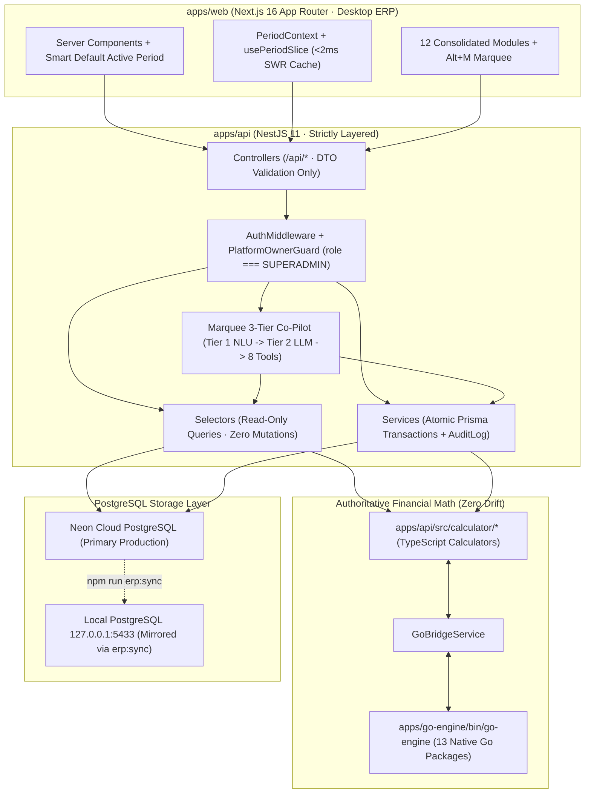

# Architecture & UX Flow — Sunday Funday ERP V2.5

## 1. End-to-End Request & Engine Topology

---

## 2. User Journey & Paycycle Lifecycle Flow

```mermaid
flowchart LR
    Landing["1. Smart Default Period Landing (/api/snapshots/default-period)"] --> PrePayday["2. PRE_PAYDAY State (Countdown + Bridge Callout)"]
    PrePayday --> Wizard["3. Payday & Closing Wizard (/payday-wizard)"]
    Wizard --> Step1["Step 1: Confirm Paycheck & Working Days"]
    Step1 --> Step2["Step 2: Lock Prior Cycle (closeSnapshot)"]
    Step2 --> Step3["Step 3: Settle Due-Date Bills (11th CC / 25th PayLater)"]
    Step3 --> Step4["Step 4: Confirm P1 Vault Deposit & Release Living Pool"]
    Step4 --> Active["4. ACTIVE Daily Pacing & Cash Radar (/ & /calendar)"]
    Active --> Capture["5. Daily Capture (Overview Form / Alt+M Marquee / Webhook)"]
    Capture --> Reports["6. Executive Statements & 4-Sheet Excel Dispatch (/reports)"]
```

---

## 3. Role Isolation & Security Architecture

| Account | Username | Role | Blueprint | `/admin` & `/admin/sql` Access | Purpose |
| :--- | :--- | :--- | :--- | :--- | :--- |
| **User #1 (Gabriel)** | `cheeseburger` | `USER` | `SUPERADMIN_BESPOKE` | **Denied (`403 Forbidden`)** | Live production personal finance workspace (`userId = 1`). |
| **User #2 (Demo)** | `guest` | `DEMO_SANDBOX` | `STANDARD_GENERAL` | **Denied (`403 Forbidden`)** | Public evaluation sandbox & destructive E2E mutation target (`userId = 2`). |
| **System Superadmin** | `superadmin` | `SUPERADMIN` | `SUPERADMIN_BESPOKE` | **Granted (`200 OK`)** | Dedicated platform administration, tenant provisioning, and SQL Studio. |

---

## 4. Top-Layer `<dialog>` Drawer & Zero-Jank Tab Architecture

1. **Instant Sub-Module Switching (`syncSubInUrl` & `.tab-panel`):**
   - Intra-route sub-module navigation (`/credit?sub=contracts`, `/reports?sub=audit`, `/preferences?sub=ai`) updates URL parameters via `window.history.pushState` and dispatches `erp:sub-change`, switching panels in `<10ms` without triggering a Next.js `_rsc` roundtrip.
2. **Native Top-Layer `<dialog>` Drawer (`MarqueeCoPilotDrawer.tsx`):**
   - Uses native `<dialog>` with `showModal()`, `aria-labelledby`, `dialog:modal { overscroll-behavior: contain }`, and `dialog::backdrop { overflow: hidden; overscroll-behavior: contain }` — avoiding `html`/`body` overflow mutation layout shifts.
   - Outside-click light dismissal checks both `pointerdown` and `pointerup` coordinates against `getBoundingClientRect()` so text-selection drags never accidentally dismiss the drawer.
