# Entity-Relationship Diagram (ERD) — Sunday Funday ERP V2.5

This document defines the physical PostgreSQL schema (`apps/api/prisma/schema.prisma`) across Neon Cloud and Local PostgreSQL (`127.0.0.1:5433`).

---

## 1. Complete Mermaid ER Diagram

```mermaid
erDiagram
    User ||--o{ LiabilityLineItem : "owns (cascade)"
    User ||--o| GlobalConfig : "userId (1:1 config)"
    User ||--o{ MonthlySnapshot : "userId (1:N cycles)"
    User ||--o{ CreditContract : "userId (1:N contracts)"
    User ||--o{ ScheduledBill : "userId (1:N recurring bills)"
    User ||--o{ MonthlyBulkBill : "userId (1:N period summaries)"
    User ||--o{ CreditCardTransaction : "userId (1:N card charges)"
    User ||--o{ SavingsManualTransaction : "userId (1:N vault entries)"
    User ||--o{ SavingsGoal : "userId (1:N goals)"
    User ||--o{ WishlistItem : "userId (1:N planned purchases)"
    User ||--o{ AuditLog : "userId (1:N audit trail)"
    User ||--o{ CustomFeatureRequest : "userId (1:N bespoke requests)"
    User ||--o{ TrustedIpAddress : "userId (1:N whitelisted IPs)"
    User ||--o{ PeriodCommitment : "userId (1:N one-off commitments)"
    User ||--o{ TripEventPlan : "userId (1:N event budgets)"
    User ||--o{ TripExpenseItem : "userId (1:N event expenses)"
    User ||--o{ SinkingFundItem : "userId (1:N sinking funds)"
    TripEventPlan ||--o{ TripExpenseItem : "tripEventId (cascade expenses)"
    TripEventPlan ||--o{ PeriodCommitment : "tripEventId (optional deposit)"

    AuthRateLimit {
        string key PK "email_or_user:normalizedIp"
        int attempts
        datetime firstAttemptAt
        datetime lockedUntil "429 lockout expiry"
        datetime updatedAt
    }

    MonthlySnapshot ||--o{ Transaction : "snapshotId (1:N ledger rows)"
    MonthlySnapshot ||--o{ BudgetRevision : "snapshotId (cascade revisions)"

    User {
        int id PK
        string accountName
        string username
        string email UK
        string passwordHash
        string fullName
        string role "SUPERADMIN | USER | BESPOKE_CLIENT | STANDARD_MEMBER | DEMO_SANDBOX"
        string status "ACTIVE | SUSPENDED"
        string blueprintType "SUPERADMIN_BESPOKE | BESPOKE_CUSTOM | STANDARD_GENERAL"
        string lifeStagePreset
        string uiDensityMode
        string securityPinHash
        boolean ipWhitelistEnforced
        datetime createdAt
        datetime updatedAt
    }

    TrustedIpAddress {
        int id PK
        int userId FK
        string ipAddress
        string label
        boolean isActive
        datetime lastUsedAt
        datetime createdAt
    }

    GlobalConfig {
        int id PK
        int userId UK
        float baseSalary
        float dailyAllowance
        float laptopAllowance
        float dailyOperational
        float transport
        float internet
        float vape
        float haircut
        float baseSavings
        float creditLimit
        int creditStatementDay "Default 25 (Permata CC)"
        int creditDueDay
        int payrollPayoutDay
        int ccUsageLimit
        int paylaterUsageLimit
        json payrollRulesJson
        json allocationBucketsJson
        json surplusSplitRulesJson
        json financialPolicyJson "studioConfig + walletCheckins + marqueeAi (AES-256-GCM)"
        boolean autoCloseEnabled
        int autoCloseAfterDays
        int activeTrackingStartMonth
        int activeTrackingStartYear
        float targetWealthAmount
        int targetWealthMonth
        int targetWealthYear
        string targetWealthBase
        string profileMode
        string lifeStagePreset
        string uiDensityMode
        boolean onboardingCompleted
        json customRoutineLabelsJson
        json customRoutineCategoriesJson
        json sandboxStateJson
        string payrollMode
        json enabledModulesJson
        string formulaEngineType
        json formulaParamsJson
        int killSwitchLeadDays
        boolean killSwitchBannerEnabled
        string killSwitchNotifyEmail
        string killSwitchSmtpUser
        string killSwitchSmtpAppPassword "Encrypted SMTP App Password"
        datetime createdAt
        datetime updatedAt
    }

    MonthlySnapshot {
        int id PK
        int userId FK
        int month "1..12 (UK with userId, year)"
        int year
        enum status "DRAFT | LOCKED"
        float salaryAdjustment
        int totalWorkingDays
        float cafeteriaDeduction
        float thrAmount
        float bonusAmount
        float dailyOperational
        float transport
        float internet
        float vape
        float haircut
        float savings
        float selfRewardTarget
        float bufferPocket
        int ccUsageLimit
        int paylaterUsageLimit
        float netSalaryIncome
        float extraIncome
        float finalTotalIncome
        float totalDeductions
        float actualDailyOperational
        float actualSavings
        float selfReward
        float deficitUncovered
        float survivalPocket
        datetime payrollPayoutDate
        boolean isPayoutDateConfirmed
        boolean isManualOverride
        float lockedP1
        float lockedP2
        float bridgeInflowAmount
        json oneOffBillsJson
        datetime createdAt
        datetime updatedAt
    }

    Transaction {
        int id PK
        int snapshotId FK
        enum type "INCOME | DEDUCTION | CREDIT_BILL"
        enum sourceType "MANUAL | CONTRACT | CC_TRANSACTION | BULK_BILL | PERSONAL_DEBT | OPERATIONAL_REFUND"
        int sourceId
        enum fixedEssentialCategory "TRANSPORT | INTERNET | VAPE | HAIRCUT"
        string bucketKey
        string label
        float amount
        datetime date
        datetime createdAt
    }

    MonthlyBulkBill {
        int id PK
        int userId FK
        string label
        float paylaterAmount
        float personalDebtAmount
        float creditCardAmount
        float amount
        int month "UK with userId, year"
        int year
        datetime createdAt
        datetime updatedAt
    }

    LiabilityLineItem {
        int id PK
        int userId FK
        int month
        int year
        enum category "PAYLATER | PERSONAL_DEBT | CREDIT_CARD | P1_VAULT_REFUND"
        string title
        string merchantOrPlatform
        float principalAmount
        float monthlyAmount
        int tenorMonths
        int installmentIndex
        int cutoffDay
        int dueDay
        boolean isSettled
        string parentContractId
        string notes
        datetime createdAt
        datetime updatedAt
    }

    CreditCardTransaction {
        int id PK
        int userId FK
        string label
        float amount
        float totalAmount
        float monthlyAmount
        enum chargeType "FULL | INSTALLMENT | RECURRING"
        int tenor
        string category
        datetime transactionDate
        int billingMonth
        int billingYear
        int endedAtMonth
        int endedAtYear
        boolean isRecurring
        boolean isActive
        enum status "ACTIVE | SETTLED | CANCELLED"
        boolean killSwitchEnabled
        datetime promoEndDate
        int postPromoNormalAmount
        datetime createdAt
        datetime updatedAt
    }

    CreditContract {
        int id PK
        int userId FK "Index + Cascade Delete to User"
        string label
        float principalAmount
        float monthlyInstallment
        int totalTenor
        int remainingTenor
        boolean isActive
        int startMonth
        int startYear
    }

    ScheduledBill {
        int id PK
        int userId FK "Index + Cascade Delete to User"
        string label
        float amount
        int dueDayOfMonth
        boolean isActive
    }

    SavingsManualTransaction {
        int id PK
        int userId FK
        string label
        float amount
        enum instrumentType "LIQUID_CASH | INVESTMENT_RDPU"
        datetime date
        datetime createdAt
    }

    SavingsGoal {
        int id PK
        int userId FK
        string name
        float targetAmount
        float currentAllocatedAmount
        int targetMonth
        int targetYear
        string category
        int wishlistItemId
        boolean isCompleted
    }

    WishlistItem {
        int id PK
        int userId FK
        string name
        float price
        enum fundingType "CASH | INSTALLMENT"
        string provider
        int tenor
        float monthlyPayment
        float interestPercent
        int targetMonth
        int targetYear
        enum status "PLANNING | READY | PURCHASED"
        int priority
    }

    BudgetRevision {
        int id PK
        int snapshotId FK
        int month
        int year
        enum category
        string bucketKey
        string bucketLabel
        float previousValue
        float newValue
        float difference
        string reason
        datetime createdAt
    }

    AuditLog {
        int id PK
        int userId FK
        string action
        enum category "TRANSACTIONS | LIABILITIES | SAVINGS | SETTINGS | BUDGET"
        string summary
        string details
        int month
        int year
        enum severity "INFO | WARNING | DEFICIT | ADJUSTMENT"
        datetime createdAt
    }

    CustomFeatureRequest {
        int id PK
        int userId FK
        string title
        string category
        string currentWorkflowDescription
        string desiredBehavior
        string priority
        string status
        int estimatedSetupFee
    }

    PeriodCommitment {
        int id PK
        int userId FK
        int month
        int year
        string title
        string category "OUTING | PENALTY | EVENT | FAMILY | MEDICAL | TRAVEL | OTHER"
        float amount
        datetime dueDate
        string fundingSource "PAYCHECK_UPFRONT | DISCRETIONARY | EMERGENCY_BUFFER"
        string status "UNPAID | RESERVED | PAID"
        int tripEventId FK
    }

    TripEventPlan {
        int id PK
        int userId FK
        int month
        int year
        string title
        string eventType "OUTING | VACATION | WEEKEND | DINNER | CONCERT | OTHER"
        datetime startDate
        datetime endDate
        float plannedCapRp
        string recommendedTier "CONSERVATIVE | BALANCED | MAX_SAFE"
        string status "PLANNING | ACTIVE | COMPLETED | CANCELLED"
        float sweptUnusedRp
        string sweptTo "CORE_SAVINGS | DISCRETIONARY"
    }

    TripExpenseItem {
        int id PK
        int tripEventId FK
        int userId FK
        datetime date
        string label
        string category
        float amountRp
        boolean isSharedAdvance
        string counterpartyName
        float reimbursedAmountRp
        boolean isSettled
    }

    SinkingFundItem {
        int id PK
        int userId FK
        string name
        string category
        float targetAmountRp
        float savedAmountRp
        int targetMonth
        int targetYear
        boolean isActive
    }
```

---

## 2. Conservation & Parity Invariants Across Tables

1. **`LiabilityLineItem` <-> `MonthlyBulkBill` Parity:**
   - For every `(userId, month, year)`, the sum of `LiabilityLineItem.monthlyAmount` grouped by `PAYLATER` and `PERSONAL_DEBT` (plus `P1_VAULT_REFUND`) reconciles 1:1 with `MonthlyBulkBill.paylaterAmount` and `MonthlyBulkBill.personalDebtAmount`.
2. **No Double Counting (`CreditContract` vs `LiabilityLineItem` / `CreditCardTransaction`):**
   - `CreditContract` is a historical contract registry and is **never** added on top of `MonthlyBulkBill` or `CreditCardTransaction` during waterfall deduction math.
3. **JSON Policy Extension (`GlobalConfig.financialPolicyJson`):**
   - Houses `studioConfig` (2-stage formula rules, `defaultPeriodStrategy`), `walletCheckins` (per-period balance guard snapshots), and `marqueeAi` (AES-256-GCM encrypted BYOK keys and SHA-256 `webhookTokenHash`), avoiding destructive schema resets.
